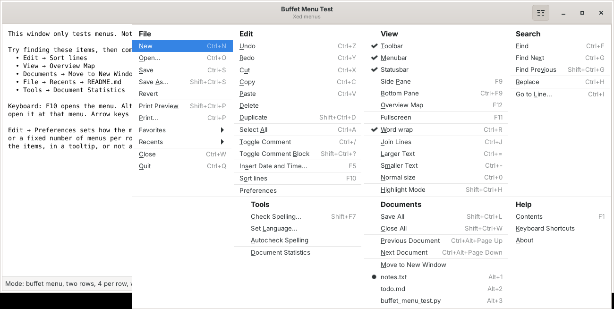
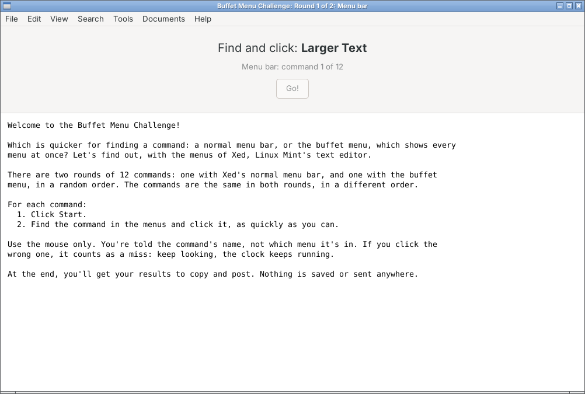
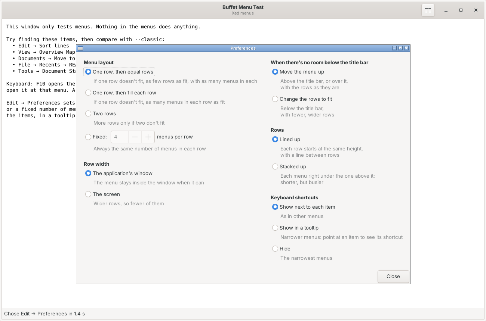
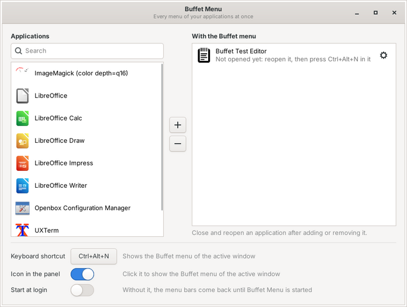

# Buffet menu

**Is it in Edit or Tools?** The Buffet menu shows every menu of an application at once, side by side,
from one button in the header bar. Everything is laid out in front of you, like a buffet: two clicks to
any command, and no more opening one menu after another to find it.



It's an experiment for GTK3 applications in the Linux Mint XApp style. It keeps what makes a menu bar
easy to use (File, Edit, View…, keyboard shortcuts next to the items, access keys) and takes no more room
than a header bar's hamburger menu.

## Try the Buffet Menu Challenge

Which is quicker: a normal menu bar, or the Buffet menu? The challenge times you finding 12 commands in
the menus of Xed, Linux Mint's text editor: one round with the menu bar, one with the Buffet menu, in a
random order. It takes about 2 minutes, with the mouse only.



1. Download `buffet_challenge.py` and `buffet_menu_test.py` into the same folder (or the whole project:
   **Code → Download ZIP**).
2. In a terminal, in that folder:
   ```bash
   python3 buffet_challenge.py
   ```
3. **Before you start, size the window the way you normally use Xed**: maximised, or the size you
   usually keep it. The second round opens at the same size.
   You'll also be asked how often you use Xed: if you use it a lot, you know where its menu bar keeps
   things, and the results show that.
4. At the end, click **Copy results** and paste them where you were asked to share them.

The menus don't do anything: they're only for finding. Nothing is saved, nothing is installed, and
nothing is sent anywhere. It doesn't need administrator rights. You can read the code first.

**Requirements:** Linux, with Python 3, GTK 3 and PyGObject. These come with Linux Mint, Ubuntu and most
GTK desktops (on Fedora: `python3-gobject`). On a Wayland session (Ubuntu's or Fedora's GNOME, for
example), start it with `GDK_BACKEND=x11 python3 buffet_challenge.py`, so that the Buffet menu can place
its pop-up.

## The test window

`buffet_menu_test.py` is a window with Xed's menus as a Buffet menu, to try it out freely:

```bash
python3 buffet_menu_test.py            # the Buffet menu, as set in Edit → Preferences
python3 buffet_menu_test.py --classic  # the same menus as a normal menu bar
```

Open the menu with the button at the top right, or with F10. Alt+F, Alt+E… open it at a menu, and the
arrow keys move across the columns. The status line shows how long it took to choose an item.

**Edit → Preferences** sets how the menu looks:

- **Menu layout:** one row, then equal rows (7 menus become 4 + 3); one row, then fill each row; two
  rows; or a fixed number of menus per row. Shorter rows line up on the right, near the button.
- **Row width:** as wide as the application's window, or the screen.
- **When there's no room below the title bar:** move the menu up (above the title bar, or over it), or
  change the rows to fit.
- **Rows:** lined up, or stacked up (each menu right under the one above it: a shorter menu).
- **Keyboard shortcuts:** next to each item, in a tooltip, or hidden.



When the menus are too tall for the screen, the menu scrolls.

## The Buffet Menu app (beta)

`buffet_menu.py` gives your own applications the Buffet menu, without changing them. Choose the
applications in its window, then click the Buffet button in one of them, or press **Ctrl+Alt+N**,
to see all its menus at once.

1. Install what it needs:
   ```bash
   sudo apt install appmenu-gtk3-module gir1.2-keybinder-3.0
   ```
2. Download the project (**Code → Download ZIP**) and keep its files together in one folder.
3. Start it:
   ```bash
   python3 buffet_menu.py
   ```
4. In its window, choose an application on the left and click **+**. Then close the application and
   open it again from the menu: its menu bar is gone, and **Ctrl+Alt+N** shows its Buffet menu.
5. For the **header bar with the Buffet button**, build Buffet Menu's GTK module once, then start Buffet
   Menu again:
   ```bash
   sudo apt install build-essential libgtk-3-dev
   ./build.sh
   python3 buffet_menu.py --quit; python3 buffet_menu.py
   ```
   The applications you've added then open with a header bar in place of their title bar: their title,
   the Buffet button and the window buttons.



- **Each application has its own settings:** click the gear next to it. The first time its Buffet menu
  opens, it picks one row for an application with up to 4 menus, two rows for more.
- **Keyboard shortcut and Start at login** are at the bottom of the window. Start at login is on from
  the start; without it, the applications' menu bars come back until Buffet Menu is started again.
- **How it works:** `+` puts a copy of the application's menu entry in `~/.local/share/applications`. It
  starts the application with `appmenu-gtk-module`, which publishes its menu bar on D-Bus, the way global
  menu panels read it, and with Buffet Menu's own module (`buffet-headerbar.c`), which gives its main
  window the header bar and hides its menu bar while Buffet Menu runs (other applications keep theirs).
  `−` deletes the copy, and the application is as it was.
- **Works with** GTK3 applications that have a menu bar, on X11 (Cinnamon, MATE and Xfce on Linux Mint).
  Tried with Xed, Nemo, LibreOffice, Inkscape 1.x, Pluma, Mousepad, gedit, Code::Blocks and Xcalculator. The list only offers
  GTK3 applications; one that turns out to have a header bar of its own (and no menu bar behind it) or no
  menu bar is taken off the list when it first opens. Tick **Show all applications** to see the others,
  and why they're left out. Not with GTK2 applications (GIMP 2.10), GTK4, Qt, Flatpak or Wayland.
- **To stop it:** `python3 buffet_menu.py --quit`.

## License

GPL-3.0. See [LICENSE](LICENSE).
